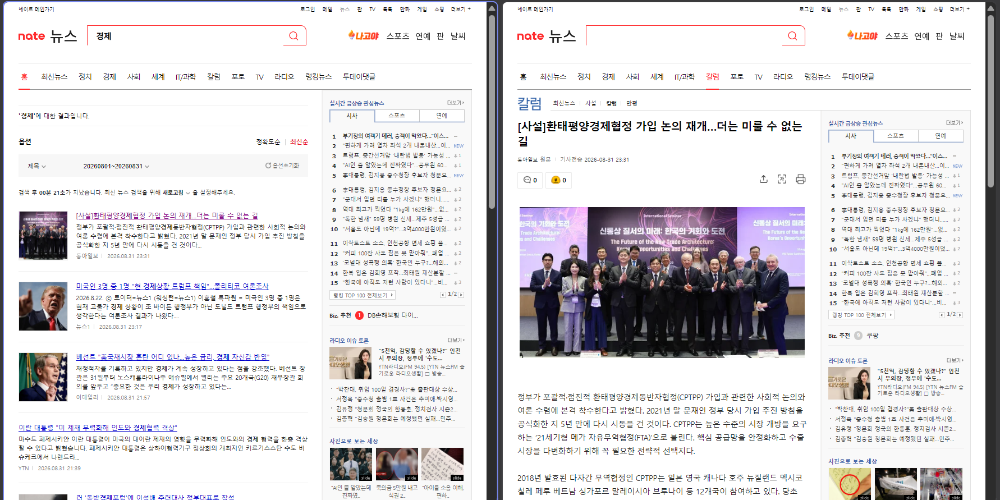
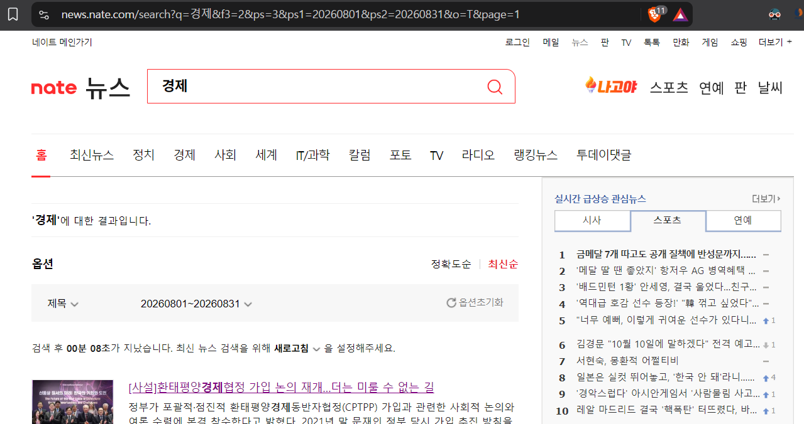

## 크롤링

회사에서 기획 업무를 하다보면, 최신 트렌드 파악, 거시경제 동향 조사, 제도 변경이 업계에 주는 영향력 분석 등등 보고를 해야할 때가 있다.

예전에는 시간을 들여서 일일이 검색했겠지만, AI를 활용하는 시대이니만큼, 기간을 설정하여 원하는 키워드로 뉴스를 긁어 모으고, 그 결과를 AI에 줘서 분석도 시키는 방법을 시도해보았다.

아래부터는 **바이브 코딩으로 뉴스 크롤링하는 python 스크립트를 작성**해 본 경험을 소개한다. 참고로, HTML 웹사이트 구조를 어느정도 알고 있고, 크롬 개발자도구를 사용해봤고, Python 설치 및 스크립트 실행을 할 줄 아는 상태에서 진행하였다.

## 네이트 뉴스

먼저 크롤링 대상이 되는 뉴스 사이트로 [네이트 뉴스](https://news.nate.com/)를 아래와 같은 장점이 있어 선택했다.

> - 웹사이트가 정적 페이지로 구성 → 사이트 접속했을 때 최종 완성된 페이지를 그대로 가져오기 때문에 가장 기본적인 크롤링 툴 사용에 적합
> - 네이트 기본 제공 양식에 맞춰 제공 → 언론사 웹페이지가 아니기 때문에 언론사마다 크롤링 대상을 일일이 맞춰줘야할 필요가 없음
> - 사이트 자체가 크롤링에 덜 민감 → 매우 빠른 간격으로 사이트를 헤집고 다닌다면, bot 같은 것으로 생각해서 접근을 차단하는 사이트들이 많은데, 아직까지 네이트에서 차단당한 경험은 없음

말하자면 정적 웹사이트로 **구조가 단순하고, 단일 양식이고, 크롤링 위한 접근에 관대**하기 때문이다.

## 크롤링 준비

크롤링 대상이 되는 사이트를 웹브라우저에서 이리저리 돌려보면서, 사이트 특성과 어떻게 크롤링할 것인지 미리 생각을 해둬야 한다.

뉴스를 검색하면 리스트를 나열해주는 페이지와 리스트에서 뉴스 링크를 클릭하면 뉴스 본문 자체를 보여주는 페이지로 크게 나눌 수 있다. 그래서 **뉴스 리스트를 수집하는 스크립트**와 링크를 찾아다니며 **뉴스 본문을 수집하는 스크립트**, 총 2 개가 필요하겠구나 라고 생각이 들었다.



<p class="caption">왼쪽은 뉴스 리스트 페이지, 오른쪽은 뉴스 본문 페이지</p>

ai 는 copilot 무료 버전을 사용했다. 무료 버전으로도 충분히 작업이 가능했고, ai로하여금 스스로 AGENTS.md 를 계속 업데이트하도록 지시했다.

장황한 프롬프트 대신 AGENTS.md에 기록된 내용을 바탕으로 실제 바이브 코딩 작업을 설명해 보고자 한다.

```markdown
## 프로젝트 현황

이 프로젝트는 네이트 뉴스 크롤링을 2단계로 나누어 처리하는 구조로 개발 중입니다.

1. 검색어와 검색 기간으로 네이트 뉴스 검색
2. 검색 결과에서 말줄임 처리된 제목, 뉴스 링크, 표시 날짜 수집
3. 수집 결과를 CSV 파일로 저장

첫 번째 단계인 검색 결과 목록 크롤러와 두 번째 단계인 각 뉴스 링크 접속 후 완전한 제목과 본문 수집 크롤러가 구현되어 있습니다.
```

기술 스택은 아래와 같다.

```markdown
## 개발 환경 및 의존성

- Python: `>=3.12`
- 패키지 관리 및 실행 도구: `uv`
- HTML 파서: `beautifulsoup4`
- HTTP 클라이언트: `requests`
- CSV 저장: Python 표준 라이브러리 `csv`
```

정적 웹페이지이기 때문에, Python 기본 크롤링 교육 과정에 항상 언급되는 Beautifulsoup4 라이브러리를 사용하도록 지시했다. 그리고 개인적으로 uv 패키지 관리자을 선호하기 때문에 uv도 사용하도록 시켰다.

나머지는 ai에게 스스로 적절히 판단해 달라고 요청했다.

## 뉴스 리스트 수집 스크립트

````markdown
크롤러는 다음 형식의 검색 URL을 생성합니다.

```text
https://news.nate.com/search?q={query}&f3=2&ps=3&ps1={start_date}&ps2={end_date}&o=T&page={page}
```

검색 페이지 1부터 100까지 순서대로 접속하며, 페이지의 `ul.search-list li` 요소가 없으면 더 이상 수집하지 않고 종료합니다.
페이지 요청 사이에는 1초의 대기 시간을 둡니다.
````

네이트 뉴스는 검색할 때 검색조건을 넣을 수 있는데, `제목`만 포함, `기간`을 설정, `최신순` 정렬로 정한뒤 웹브라우저의 주소창을 보면, 위 마크다운에 보이는 웹주소(url)와 유사하게 형태의 주소가 보인다.

검색 조건식이 URL에 반영되도록 설계되어 있는 것 같은데, 다른 옵션을 주면 웹주소 형태가 달라지는 것도 아래처럼 확인할 수 있다.



<p class="caption">검색조건에 따라 URL 주소가 달라짐</p>

크롤링을 해야하는 입장에서는 이 경우 매우 편리한데, 정확한 검색 조건 자체를 URL로 직접 조립해서 웹페이지 요청을 할 수 있기 때문이다.

참고로 url 쿼리 스트링을 보면 `page`가 보이는데, 감각적으로 무슨 의미인지 알 수 있을 것이다. ai가 작성한 스크립트를 실행하기 전에 수동으로 몇가지 테스트를 해보니 중요한 점을 하나 알 수 있었는데, **네이트 뉴스는 최대 100 페이지까지만 노출을 허용**한다는 점이다.

예를들어 나머지 url 쿼리 스트링은 동일하게 두고, `page`에 100과 101을 각각 입력하여 페이지 요청을 해보면 동일한 페이지가 나온다는 점을 확인할 수 있다.

아쉽게도 이 점은 네이트 뉴스가 그렇게 작동하도록 설계되어있는 부분이라 어떻게 할 수 있는 것이 아니기에, 만일 원하는 기간의 뉴스 리스트 웹페이지 수가 100을 넘는다면 기간을 조정하든가 해야 할 것 같다.

````markdown
각 검색 결과에서 다음 정보를 수집합니다.

- `news_date`: `span.time` 요소의 텍스트
- `news_title`: `h2.tit` 요소의 텍스트
- `news_link`: `a` 요소의 `href` 속성

`news_title`은 줄바꿈, 탭, 연속 공백 등 모든 공백 문자를 하나의 일반 공백으로 바꾸고 앞뒤 공백을 제거합니다.

`news_date`는 줄바꿈, 탭, 연속 공백 등 모든 공백 문자를 `|` 하나로 바꿉니다. 예를 들어 다음과 같이 저장됩니다.

```text
티브이데일리|2026.08.01|00:12
```
````

사전에 크롬 개발자도구로 뉴스 리스트 웹사이트 구조를 미리 살펴보고, 생각보다 깔끔한 형태라 크롤링 대상이 되는 html 태그도 쉽게 찾아낼 수 있었다.

수집해야하는 정보(언론사 포함 날짜, 제목, 링크)가 어느 html 태그에 속해있는지를 ai에게 직접 알려줬으며, 그리고 수집한 결과물에 대해서 나름 데이터 클렌징도 거치도록 지시했다.

````markdown
CSV 컬럼 순서는 다음과 같습니다.

```text
news_date,news_title,news_link
```

CSV는 UTF-8 BOM(`utf-8-sig`) 인코딩으로 저장하므로 Excel에서 직접 열 수 있습니다.
크롤러를 새로 실행하면 기존 결과 파일을 비우고 새 결과를 수집합니다.
````

수집된 정보는 csv 파일로 저장하도록 요청했다. 그런데 요즘 시대 인코딩은 대부분 UTF-8이지만 엑셀은 과거 호환성 때문에 순수 UTF-8로만 저장된 CSV를 그대로 로드하면 한글이 깨지는 경우가 많음, AI에게 이를 방지하기 위한 적절한 조치를 요청함

## 뉴스 본문 수집 스크립트

```markdown
첫 번째 단계에서 생성한 `crawl_news_output.csv`를 입력으로 사용합니다.
입력 파일이 없으면 오류를 발생시키고 종료합니다.
CSV 전체를 메모리에 올리지 않도록 20개 단위의 배치로 읽고, 배치 안의 기사를 하나씩 처리합니다.
입력 파일이 없을 때는 traceback 대신 원인과 조치 방법을 한글 안내로 출력하고 종료 코드 `1`을 반환합니다.
```

- 뉴스 리스트 수집 스크립트를 실행하면 만들어지는 CSV 파일이 있어야 작동하도록 했다. 보통은 CSV 파일을 한번에 모두 읽은 뒤(전체 CSV 파일 내용을 메모리에 올린 뒤) 작업을 하게 되겠지만, 혹시 모를 메모리의 부담이 있지않을까 생각되어 배치 방식으로 작동하도록 지시함

```markdown
각 `news_link`에 접속해 다음 요소를 수집합니다.

- `news_title`: 먼저 `div#articleView h1.articleSubecjt`의 텍스트를 찾고, 없으면 `div#articleView h1.articleSubject`의 텍스트를 사용
- `news_body`: `div#articleView div#realArtcContents`의 텍스트

본문을 수집할 때 `img`와 `script` 요소는 제거합니다.
제목과 본문은 줄바꿈, 탭, 연속 공백 등 모든 공백 문자를 하나의 일반 공백으로 바꾸고 앞뒤 공백을 제거합니다.
```

- 뉴스 본문을 크롬 개발자도구로 보면 이미지나 광고 스크립트와 같은 HTML 태그들이 포함되어 있는 경우가 있는데 이들은 수집할 필요 없으므로 스킵하도록 지시함, 그리고 본문 내용도 데이터 클렌징을 거치도록 했음

````markdown
결과는 `crawl_news_article_output.csv`에 기사 하나를 처리할 때마다 즉시 저장합니다. 결과 컬럼 순서는 다음과 같습니다.

```text
news_date,news_title,news_link,news_body
```

`news_date`와 `news_link`는 원본 CSV 값을 사용하고, `news_title`과 `news_body`는 기사 페이지에서 새로 수집한 값을 사용합니다.
기사 처리 상태는 콘솔에 표시되며, 요청 사이에는 1초의 대기 시간을 둡니다.
개별 기사 수집에 실패해도 오류를 출력하고 해당 행을 빈 제목·본문으로 저장한 후 다음 기사 처리를 계속합니다.
출력 파일은 UTF-8 BOM(`utf-8-sig`)으로 저장되어 Excel에서 직접 열 수 있습니다.
````

- 뉴스 본문까지 포함된 결과를 최종 CSV로 출력하도록 하는데, 뉴스 제목 `news_title`만큼은 뉴스 본문 수집 스크립트에서 다시 정보를 가져와서 기존 것을 교체하도록 했음
- 이유는 **뉴스 검색 페이지에서는 너무 긴 제목에 대해서는 말줄임표를 사용**하고 있었기에, 말 줄임표가 없는 뉴스 본문의 제목을 수집하기 위함임

<!--adsense-->

## 참고사항
- ai 가 두개 스크립트를 잘 만들어줘서 나름 잘 사용했음, 다만 주의 사항이 있는데 **중복된 기사 처리는 없다는 점**임
- 특히 뉴스 검색이 100 페이지를 넘어가서 일자를 조절해가며 여러번 링크 수집하거나, 다양한 주제로 뉴스 검색한 결과를 합칠 때 중복이 발생할 확률이 높을 것임
- 바이브코딩하면서 중복 기사 처리 생각을 하긴 했는데, 그냥 첫번째 스크립트의 결과인 뉴스 링크 수집 CSV 파일을 아무 AI에게나 던지고 중복 링크는 삭제해달라고하면 되기 때문에 굳이 토큰 낭비해가며 바이브코딩으로 스크립트를 짜 넣지는 않았음
- 그리고 최종 결과물(뉴스 본문까지 수집한 CSV 파일)까지 완료되었다면, AI에게 던져주고 트렌드 분석이든 주요 키워드를 뽑아내든 원하는 대로 분석을 시키면 됨
- 전체 AGENTS.md와 Python 스크립트 2개는 본인의 [깃허브 리포지토리](https://github.com/znkblog/task/tree/main/crawling-nate-news)에 두었으니 참고 바람
