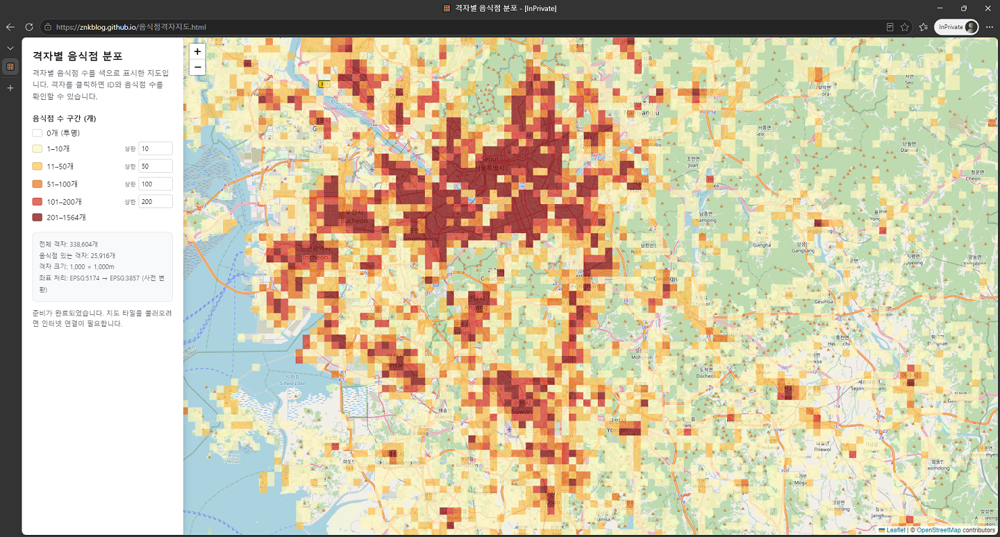

## 시각화 자료 배포
- [직전 포스팅](/post/correlation-analysis-between-commercial-districts-and-sales)에서 바이브코딩으로 상권의 측정과 상권-매출의 상관관계를 분석했었음
- 그 이후 회사 경영진은 **상권의 세기를 나타내는 1km² 단위의 격자 안에 포함된 음식점 수(단위면적당 음식점 밀집도)가 우리나라에 전반적으로 어떻게 분포**되어 있는지를 한눈에 보고 싶어 했음, 즉 시각화 자료를 요청함
- 바로 히트맵이 떠올랐음, 전국 지도를 바탕에 깔고, 그 위에 일정 크기의 격자를 좌표에 맞도록 배치하고, 격자 안의 음식점 수를 구간별로 색을 달리해서 약간 반투명하게 보이도록 하면 되겠다 싶었음
- html 파일로 만들어서 웹 브라우저에서 쉽게 열 수 있도록 하면, 누구나 어렵지 않게 볼 수 있어 사내 배포도 큰 문제없을 것 같았음
- copilot 무료 버전을 사용하여 바이브코딩으로 전반적인 html 초안을 작성했음, 결과물에 지도와 격자 좌표가 어긋나는 문제가 있었는데 copilot은 이를 잘 해결하지 못해 codex로 ai 교체해서 최종 마무리하였음
- 아래부터는 ai가 스스로 작성하도록 한 AGENTS.md 파일 중 주요 내용을 바탕으로, html 시각화 자료를 완성했던 작업을 소개해 봄

<!--adsense-->

## 프로젝트 개요와 기술 스택

```markdown
EPSG:5174 좌표로 정의된 격자별 음식점 수를 한국 지도 위에 시각화하는 단일 HTML 지도다. 사용자는 HTML 파일을 브라우저에서 열어 격자 분포를 살펴보고, 격자를 클릭해 격자 ID와 음식점 수를 확인할 수 있다.

- 원본 데이터 파일은 `격자배치결과.csv`다. CSV 칼럼은 `격자ID`, `격자좌상단좌표정보(X)`, `격자좌상단좌표정보(Y)`, `음식점카운팅`이다. X와 Y는 모두 격자 좌상단 좌표다.
```
- 위에 언급한 직전 포스팅에서 소개한 두 번째 스크립트를 실행하면 `격자배치결과.csv`라는 파일이 생성됨, 여기에는 격자의 좌표와 좌표별 음식점 수가 기록되어 있으며, 이 파일을 가져와서 단일 html 파일을 만들도록 요청함

```markdown
- **HTML/CSS/JavaScript**: 지도 화면, 왼쪽 범례, 상태 메시지와 상호작용을 한 파일에 구현한다. `file://` 실행에서 스타일 누락이 발생하지 않도록 Leaflet CSS도 HTML에 직접 포함한다.
- **Leaflet 1.9.4**: 웹 지도, 지도 이동·확대/축소, 배경 타일 및 격자 타일 레이어를 담당한다.
- **좌표 사전 변환**: 격자 모서리 좌표는 EPSG:5174에서 EPSG:3857로 미리 변환하여 HTML에 압축된 자료로 포함한다. 브라우저에서 proj4js를 실행하지 않는다.
- **배경 지도**: `file://`에서 직접 열 때 Referer 제한으로 차단되지 않는 `https://tile.openstreetmap.de/{z}/{x}/{y}.png`의 OpenStreetMap 타일을 사용한다. Leaflet은 unpkg CDN에서 불러온다.
- 결과물은 별도 CSV·CSS·JavaScript 파일이나 웹 서버가 필요 없는 단일 HTML이다. `file://`로 직접 열 수 있어야 한다.
- Leaflet JavaScript와 배경 지도 타일은 외부에서 불러오므로 실행 시 인터넷 연결이 필요하다. API 키는 사용하지 않는다. JavaScript CDN에는 SRI 무결성 속성을 적용하고, 지도에는 OpenStreetMap 저작자 표시를 항상 노출한다.

- CSV 데이터는 `음식점격자지도.html` 내부에 직접 포함한다. 파일 크기를 줄이기 위해 음식점 수가 0인 행은 포함하지 않는다. 생략된 셀은 음식점 수 0으로 취급하고 투명하게 표시한다.
- CSV의 X는 동쪽 방향 좌표(easting), Y는 북쪽 방향 좌표(northing)로 취급하고 변환 입력 순서는 `[X, Y]`다. 두 값 모두 셀 좌상단 좌표다.
- EPSG:5174의 Korean 1985 datum 변환을 포함해 전체 격자 모서리 `(556+1)×(609+1)=339,770개`를 EPSG:3857로 미리 변환한다. 변환값은 0.1m 정수로 반올림하고, 각 행의 첫 점은 두 개의 little-endian Int32, 이후 점은 직전 점과의 X/Y 차분 두 개의 little-endian Int16으로 저장한 뒤 Base64로 HTML에 포함한다.
```

- [leaflet](https://leafletjs.com/)은 모바일이나 웹 페이지에서 지도를 손쉽게 넣을 수 있도록 도와주는 오픈소스 라이브러리임, 무료이고 특별한 회원 등록 절차도 없고 다른 지도 라이브러리처럼 키를 요구하지도 않아 종종 사용하고는 함, ai에게 이 라이브러리 사용할 것 지시함
- 그리고 배경으로 깔리는 지도는 ai가 스스로 선택하도록 함, 배경 지도의 좌표계(EPSG:3857)가 격자들의 좌표계(EPSG:5174)와 달라 이를 한쪽으로 통일하도록 함
- 좌표계 통일 위해 처음에는 ai가 [proj4js](https://proj4js.org/)라는 좌표계 상호 변환 라이브러리를 html에 심고 코드 내부에서 동적으로 좌표계를 변환했었으나, 웹페이지 로딩 속도가 너무 느려서 변환을 미리 한 뒤 그 데이터를 하드코딩으로 직접 심도록 수정했음

## html 동작 정의

```markdown
- 음식점이 있는 셀은 반투명한 색상으로 표시하고, 음식점 수가 0인 셀은 완전히 투명하게 둔다.
- 왼쪽 범례는 투명한 0개 항목과 5개의 양수 구간으로 구성한다. 초기 구간은 `1–10`, `11–50`, `51–100`, `101–200`, `201–1564`다.
- 범례에서 처음 네 구간의 상한값을 편집할 수 있다. 값은 오름차순의 정수여야 하며, 유효하지 않은 변경은 적용하지 않는다.
- 격자 표시는 커스텀 Leaflet `GridLayer`에서 지도 타일 단위로 그린다. 지도를 이동하거나 확대·축소할 때 격자가 배경 지도와 함께 움직이고 크기가 바뀌어야 한다.
```

- 5단계로 색 구분을 하도록 지정했음, html 로드하면 초기값으로 색 구분을 보여주되, 색 구분 범위를 사용자가 조정할 수 있도록 함
- html 초안에서는 지도의 이동이나 확대/축소 과정에서 지도와 격자가 따로따로 움직이는 것을 확인했음, 지도와 격자가 항상 같이 움직이도록 추가로 지시함

<!--adsense-->

## 결과

- 완성된 html 파일을 웹 브라우저에서 열면 아래와 같이 나옴 [링크](https://znkblog.github.io/task/%EC%9D%8C%EC%8B%9D%EC%A0%90%EA%B2%A9%EC%9E%90%EC%A7%80%EB%8F%84.html)를 클릭하면 실제 웹 브라우저에서 어떻게 보이는지도 확인할 수 있음



- 욕심 같아서는 클릭하면 정확한 행정구역이 표시되고, 음식점의 업종도 구분하고 등등도 반영하고 싶었으나 다음으로 미뤘음
- 전체 AGENTS.md나 html 결과물을 확인하고 싶다면 본인의 [깃허브 리포지토리](https://github.com/znkblog/task/tree/main/visualize-commercial-districts)를 참고하기 바람